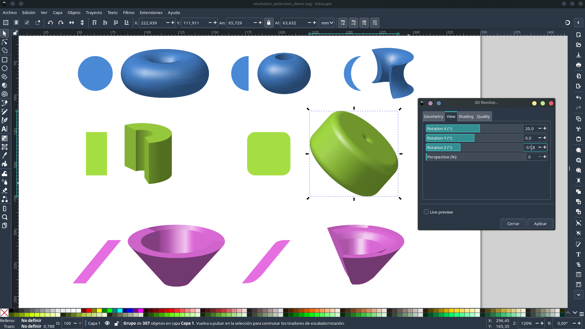
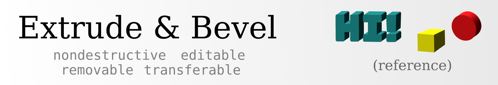
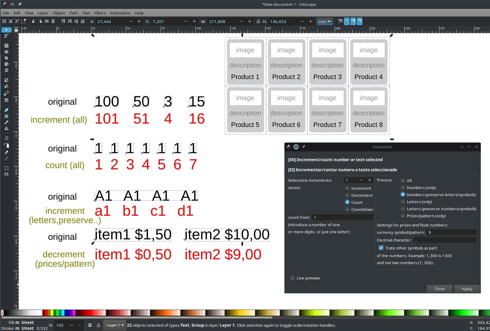

  <a href="README_ES.md">🇪🇸 Leer en Español</a>

<h1 align="center">Inkscape Extensions</h1>

  <b>A collection of Python extensions for Inkscape.</b> 
  Tools, effects, and workflows to extend what you can create in Inkscape.

  

  
  
  

---

## Support the project

If these extensions are useful to you, consider supporting development:

- **PayPal:** [Donate via PayPal](https://paypal.me/myfinancialfreedom)
- **Liberapay:** 
- **BTC Lightning:** `lnurl1dp68gurn8ghj7ampd3kx2ar0veekzar0wd5xjtnrdakj7tnhv4kxctttdehhwm30d3h82unvwqhkwmr4d4cxz6tjxvcq4f3h98`
- **BTC:** `bc1q6l6p35ghnrl5lennypu87mt7fuvvpayr9h4h0y`

    If you'd like to help fund the development, please consider making a donation and then send me an email letting me know you are donating for this extensions (buenasapps@yahoo.com) (Donations are not payments for goods or services. All donations are final and non-refundable.)
    
    Donated this month (progress bar is manually updated).
    
    I want to create a set of three 3D extensions for Inkscape. The first one, Revolve 3D, has already been created. Now, it would be great to develop an Extrude 3D extension that also supports text objects, and a third extension that simply applies a 3D perspective. All three extensions will be non-destructive.
    

---

## What's new

<!-- Add new items at the top. Keep entries short: date, what changed, and which extension. -->

- **2026-11-16** — Added extension: **[Revolve 3D](#revolve-3d)**.

---

## Extensions

<!-- Newest extension first. Duplicate the "Extension template" block from the project skill when adding a new one. -->

### Revolve 3D

Create 3D-like revolved shapes from paths in Inkscape.

  

- **What it does:** Generates a revolved/lathe-style 3D appearance from selected geometry.
- **Status:** Published
- **Tutorial:** [tutorial_revolve-3d.md](tutorial_revolve-3d.md) _(tutorial to be added)_

**Quick start**
1. Open the extension folder in this repository: [`revolve3d`](revolve3d/).
2. Download the ZIP file inside it: [`revolve3d.zip`](revolve3d/revolve3d.zip).
3. Unzip it into your Inkscape extensions folder — you can extract the loose files or, **recommended**, keep them as a subfolder inside that path.
4. Restart Inkscape.
5. Find the extension in the menu and run it on your selection.

**Support my work**

- **PayPal:** [Donate via PayPal](https://paypal.me/myfinancialfreedom)
- **Liberapay:** 
- **BTC Lightning:** `lnurl1dp68gurn8ghj7ampd3kx2ar0veekzar0wd5xjtnrdakj7tnhv4kxctttdehhwm30d3h82unvwqhkwmr4d4cxz6tjxvcq4f3h98`
- **BTC:** `bc1q6l6p35ghnrl5lennypu87mt7fuvvpayr9h4h0y`

> **Have an idea for an extension?**  
> Help me create more extensions: [open an issue](../../issues/new) with your proposal and, if this project is useful to you, consider leaving a donation to support it.

---

### In development

Smaller preview of what's coming next.

#### Increment (WIP)

  

_An upcoming extension to increment numbers (and letters) in bulk._

---

## License

Unless otherwise noted in a specific extension, code in this repository is licensed under **GPL-2.0-or-later**.

- Read the license online: [GNU GPL v2.0](https://www.gnu.org/licenses/old-licenses/gpl-2.0.html) · [GPL FAQ (or-later)](https://www.gnu.org/licenses/gpl-faq.html#VersionTwoOrLater)

---

  Made with care for the Inkscape community. Suggestions and ideas are welcome via issues.

