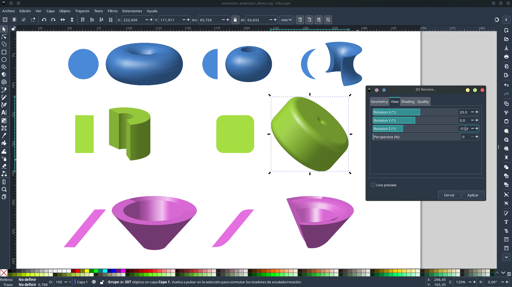
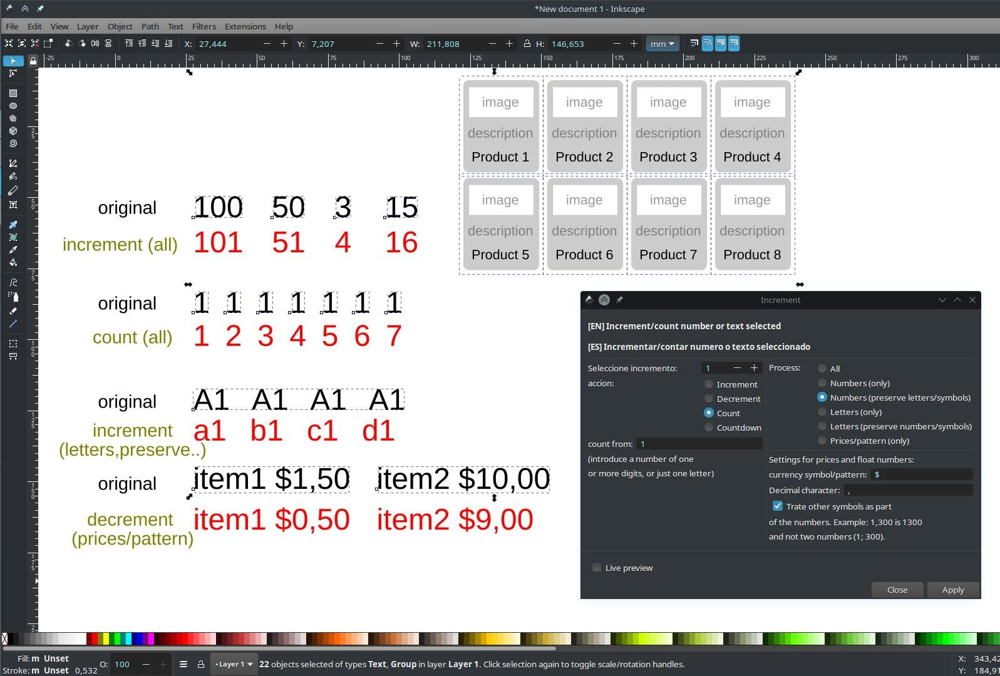

  <a href="README.md">🇬🇧 Read in English</a>

<h1 align="center">Inkscape Extensions</h1>

  <b>Una colección de extensiones en Python para Inkscape.</b> 
  Herramientas, efectos y flujos de trabajo para ampliar lo que puedes crear en Inkscape.

  

  
  
  

---

## Apoya el proyecto

Si estas extensiones te resultan útiles, considera apoyar el desarrollo:

- **PayPal:** [Donar vía PayPal](https://paypal.me/myfinancialfreedom)
- **Liberapay:** 
- **BTC Lightning:** `lnurl1dp68gurn8ghj7ampd3kx2ar0veekzar0wd5xjtnrdakj7tnhv4kxctttdehhwm30d3h82unvwqhkwmr4d4cxz6tjxvcq4f3h98`
- **BTC:** `bc1q6l6p35ghnrl5lennypu87mt7fuvvpayr9h4h0y`

---

## Novedades

<!-- Añade los nuevos elementos arriba. Mantén las entradas breves: fecha, qué cambió y qué extensión. -->

- **2026-11-16** — Se añadió la extensión: **[Revolve 3D](#revolve-3d)**.

---

## Extensiones

<!-- La extensión más reciente primero. Duplica el bloque "Plantilla de extensión" de la skill del proyecto al añadir una nueva. -->

### Revolve 3D

Crea formas con apariencia 3D por revolución a partir de trazados en Inkscape.

  

- **Qué hace:** Genera una apariencia 3D tipo revolución/torneado a partir de la geometría seleccionada.
- **Estado:** Publicada
- **Tutorial:** [tutorial_revolve-3d.md](tutorial_revolve-3d.md) _(tutorial pendiente de añadir)_

**Inicio rápido**
1. Abre la carpeta de la extensión en este repositorio: [`revolve3d`](revolve3d/).
2. Descarga el archivo ZIP que hay dentro: [`revolve3d.zip`](revolve3d/revolve3d.zip).
3. Descomprime los archivos en la carpeta de extensiones de Inkscape: puedes extraer los archivos sueltos o, **recomendado**, dejarlos como una subcarpeta dentro de esa ruta.
4. Reinicia Inkscape.
5. Busca la extensión en el menú y ejecútala sobre tu selección.

**Apoya mi trabajo**

- **PayPal:** [Donar vía PayPal](https://paypal.me/myfinancialfreedom)
- **Liberapay:** 
- **BTC Lightning:** `lnurl1dp68gurn8ghj7ampd3kx2ar0veekzar0wd5xjtnrdakj7tnhv4kxctttdehhwm30d3h82unvwqhkwmr4d4cxz6tjxvcq4f3h98`
- **BTC:** `bc1q6l6p35ghnrl5lennypu87mt7fuvvpayr9h4h0y`

> **¿Tienes una idea para una extensión?**  
> Ayúdame a crear más extensiones: [abre un issue](../../issues/new) con tu propuesta y, si este proyecto te resulta útil, considera dejar una donación para apoyarlo.

---

### En desarrollo

Vista previa breve de lo que viene.

#### Increment (en desarrollo)

  

_Una extensión para incrementar números (y letras) de forma masiva._

---

## Licencia

Salvo que se indique lo contrario en una extensión concreta, el código de este repositorio se publica bajo **GPL-2.0-or-later**.

- Leer la licencia online: [GNU GPL v2.0](https://www.gnu.org/licenses/old-licenses/gpl-2.0.html) · [FAQ de la GPL (or-later)](https://www.gnu.org/licenses/gpl-faq.html#VersionTwoOrLater)

---

  Hecho con cariño para la comunidad de Inkscape. Las sugerencias e ideas son bienvenidas vía issues.

